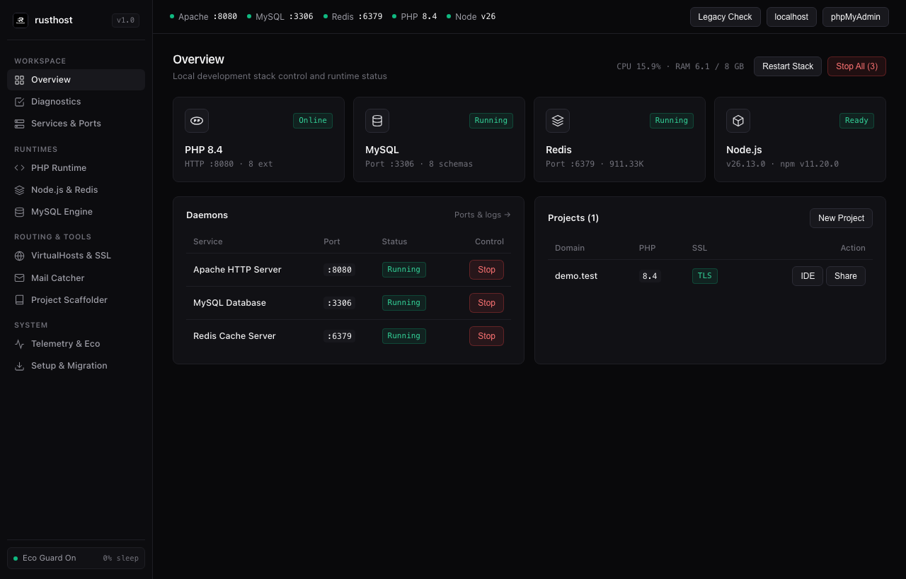
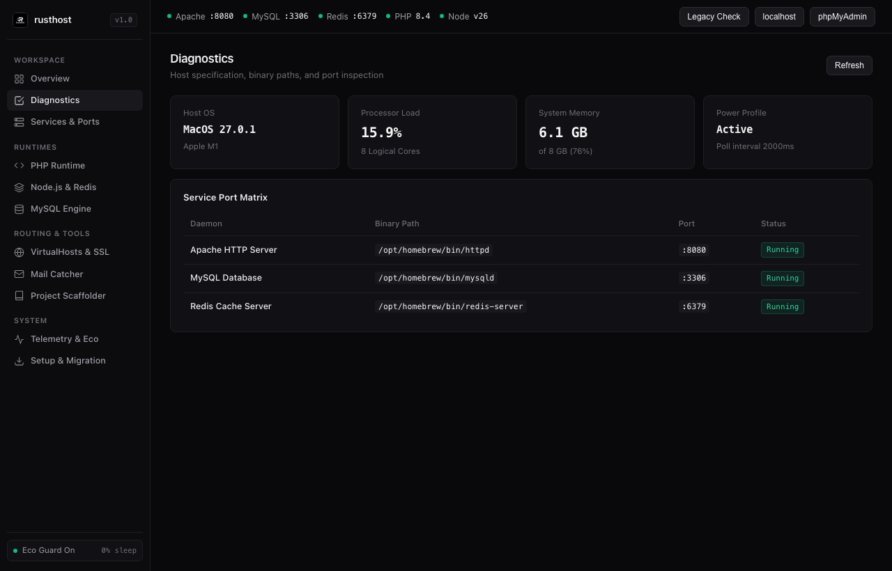
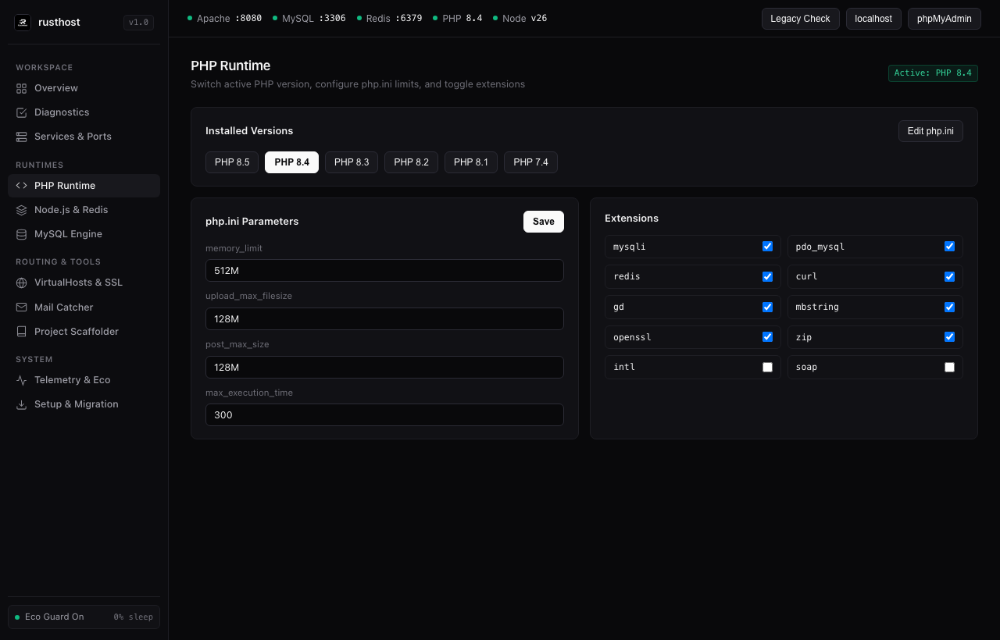
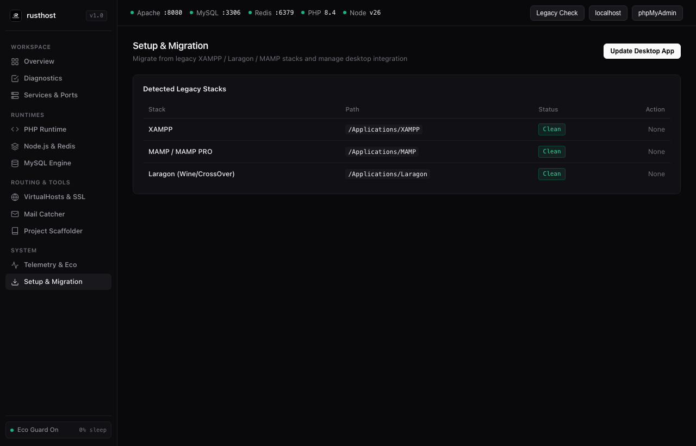

# rusthost

[](https://github.com/simbianbn/rusthost/actions/workflows/release.yml)

**`rusthost`** is a lightweight, native desktop local development stack manager (Apache, MySQL, PHP, Redis, Node.js/PM2) written in Rust (`tao` + `wry`) with a minimal monochrome dark UI and zero-wakeup sleep optimization.

---

## Screenshots (Minimal Dark UI)

### 1. Overview — 4-Stack Strip (PHP, MySQL, Redis, Node.js) & One-Click Stack Control


### 2. Diagnostics — Host Specification & Service Port Matrix


### 3. PHP Runtime — Multi-PHP Switcher (`7.4`–`8.5`), `php.ini` & Extensions


### 4. Setup & Migration — Legacy Stack Detection (XAMPP / Laragon / MAMP)


---

## Key Features

- **Native Desktop Application (`tao` + `wry`)**
  - Uses an in-process custom protocol (`rusthost://localhost/`) with zero local HTTP ports or external browser windows required.
- **Minimal Monochrome Dark Interface**
  - Unified Overview strip for **PHP**, **MySQL**, **Redis**, and **Node.js** with 1-click **Start All / Stop All** and per-service port controls.
- **Multi-PHP Runtime Manager (`7.4` – `8.5`)**
  - Instant global & per-project PHP switcher, `php.ini` tuning (`memory_limit`, `upload_max_filesize`, `post_max_size`, `max_execution_time`), and extension toggler.
- **MySQL & Redis Engine Console**
  - Live MySQL status metrics, `SHOW FULL PROCESSLIST` inspector, 1-click `.sql` backup (`mysqldump`), interactive SQL runner, and native TCP RESP Redis console.
- **VirtualHosts, Auto-SSL & LAN QR Sharing**
  - Automatic `.test` domain routing, self-signed TLS certificate generation, project scaffolder (Laravel, WordPress, Node.js, PHP), and SVG QR code generator for mobile testing.
- **Built-in SMTP Mail Catcher (`127.0.0.1:1025`)**
  - Captures outgoing local emails in memory without external dependencies.
- **Eco Guard & Zero-Polling on Sleep**
  - Uses `ControlFlow::Wait` and pauses background telemetry when minimized or when the host enters sleep mode (`0%` idle CPU overhead).
- **Legacy Stack Detector & Migrator**
  - Detects existing **XAMPP**, **Laragon**, or **MAMP** installations to migrate projects and prevent port `:80` / `:3306` conflicts.

---

## Installation & Setup

### Windows Setup (`x64`)
1. **Pre-built Setup Installer (`.exe`)**:
   - Download `rusthost-windows-x64-setup.exe` or `rusthost-windows-portable-x64.zip` from [GitHub Actions Artifacts](https://github.com/simbianbn/rusthost/actions/workflows/release.yml).
2. **One-Click Local Windows Setup**:
   ```powershell
   .\Build-And-Package.bat
   .\Install-RustHost.bat
   ```
   Or run the Windows setup wizard directly:
   ```powershell
   .\installer\windows\RustHost-Windows-Setup.bat
   ```
3. **Compile Inno Setup `.exe` Installer**:
   ```powershell
   iscc .\installer\windows\rusthost-setup.iss
   ```

### macOS Setup (`rusthost.app`)
```bash
cargo build --release
./installer/install-macos.sh
open /Applications/rusthost.app
```

### CLI Diagnostics
```bash
# Run all 8 automated verification suites
cargo run -- --self-test

# Dump current JSON state snapshot
cargo run -- --dump-state
```

---

## Project Structure

```text
├── Cargo.toml
├── project.md                              # Full technical specification
├── Build-And-Package.bat                   # Windows one-click build & package script
├── Install-RustHost.bat                    # Windows one-click GUI setup launcher
├── .github/workflows/release.yml           # Automated Windows (.exe) & macOS (.app) CI builder
├── docs/screenshots/                       # Minimal Dark UI screenshots
├── src/
│   ├── main.rs                             # Native window (tao + wry) & custom protocol IPC
│   ├── config.rs                           # Persistent configuration (~/.rusthost)
│   ├── services.rs                         # Daemon lifecycle & port conflict scanner
│   ├── monitor.rs                          # System & 6-group service telemetry
│   ├── power_saver.rs                      # Eco Guard zero-wakeup sleep engine
│   ├── php_manager.rs                      # Multi-PHP version & php.ini manager
│   ├── mysql_monitor.rs                    # MySQL status, processlist, backup & SQL runner
│   ├── node_redis.rs                       # Redis RESP client, Node.js & PM2 manager
│   ├── vhost.rs                            # VirtualHosts, Auto-SSL, QR share & scaffolder
│   ├── mail_catcher.rs                     # Built-in SMTP trap server (:1025)
│   ├── legacy_cleaner.rs                   # XAMPP / Laragon / MAMP detector & migrator
│   └── tray.rs                             # Native .app / .lnk desktop integration
├── ui/
│   ├── index.html                          # Minimal monochrome UI shell
│   ├── styles.css                          # Matte zinc dark theme (#09090b / #111115)
│   ├── app.js                              # Frontend state & IPC controller
│   ├── icon.png                            # App icon (PNG)
│   ├── icon.ico                            # Windows multi-res icon (ICO)
│   └── AppIcon.icns                        # macOS bundle icon (ICNS)
└── installer/
    ├── install-macos.sh                    # macOS .app packager & installer
    ├── uninstall-macos.sh                  # macOS uninstaller
    ├── install.ps1                         # Windows GUI installer & legacy stack cleaner
    ├── uninstall.ps1                       # Windows uninstaller
    └── windows/
        ├── rusthost-setup.iss              # Inno Setup script for rusthost-windows-x64-setup.exe
        └── RustHost-Windows-Setup.bat      # Windows Setup Wizard batch launcher
```
